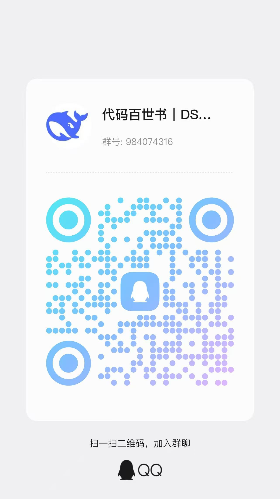

# 🤖 MengBot —— 中文优先的 AI 机器人团队

[](https://github.com/EternalNight996/mengbot/stargazers)
[](https://github.com/EternalNight996/mengbot/releases)
[](LICENSE)
[](https://mengbot.com.cn)

> **一个人干不完的活，交给一支机器人团队。**
>
> 桌面端 + 自托管服务端，中文优先，接入国内与海外主流模型；每个机器人有自己的角色、记忆、工具与工位。

## ✨ 能做什么

- 👥 **团队式协作** —— 不只一个「聊天助手」：按角色拆分机器人（指挥、工程师、运营、客服…），派活、接力、互相评审。
- 🧠 **有记忆的工作区** —— 会话、文件、任务都落在你自己的数据目录里；换台机器、重启之后接着干。
- 🔌 **连接器与技能** —— 内置连接器（邮件、日历、GitHub、Slack 等）与技能包，机器人可以直接动手而不是只会说。
- 🖥️ **桌面端体验** —— Electron 客户端：托盘常驻、开机自启、多窗口、语音、屏幕与浏览器共享。
- ☁️ **可选自托管 / 自带云** —— `docker compose` 一条命令起服务端，或用 `pnpm` 直接跑；不登录云端也能用本地能力。
- 🌏 **中文优先，15 种语言** —— 界面默认中文，附带 zh-TW / en / ja / ko / es / fr / de / it / pl / pt-BR / ru / tr / uk / vi / hi 语言包。

<p align="center"><strong>⭐ 如果它帮你省下了一个下午，点个 Star 就是最大的支持</strong></p>

## ⚡ 快速开始

**桌面端（推荐）**

到 [Releases](https://github.com/EternalNight996/mengbot/releases) 下载对应安装包：

| 平台 | 安装包 |
|---|---|
| Windows | `MengBot-0.1.140-setup.exe` |
| macOS | `MengBot-0.1.140-<arch>.dmg` |
| Linux | `.deb` / `.AppImage` |

**从源码跑（开发模式）**

```bash
pnpm install          # 需要 Node ≥ 24
pnpm dev              # 前端（Vite）
pnpm dev:server       # 本地服务端
pnpm dev:desktop      # Electron 桌面端
```

**自托管（Docker Compose）**

```bash
cp .env.example .env      # 按需修改端口与镜像
docker compose up -d      # 或：./mengbot.ps1 up -d --build
```

## 🧱 仓库结构

```text
electron/     桌面壳（主进程、预加载、更新、打包资源）
server/       HTTP/WS 服务端：会话、任务、连接器、模型路由
src/          前端（React + Vite）
shared/       前后端共享类型与工具
connector/    自托管连接器（容器镜像）
cloudflare/   Cloudflare Workers（控制平面 / broker）
apps/docs     文档站
skills/       内置技能包
scripts/      构建、打包、验证与冒烟脚本
```

常用命令：

| 命令 | 作用 |
|---|---|
| `pnpm typecheck` | 类型检查（前端 + 服务端） |
| `pnpm test` | 单元测试 + 服务端/打包冒烟 |
| `pnpm lint` | oxlint |
| `pnpm i18n:check` | 语言包完整性校验 |
| `pnpm package:prepare` | 打包前构建（服务端 / companion / 更新器 / 浏览器） |

## 🖼️ 截图

> 截图位：把图片放进 `assets/screenshots/`，然后按下面的写法引用。
> ```md
> 
> ```

| 团队工作区 | 任务与会话 |
|:---:|:---:|
| _待补_ | _待补_ |

## 💬 交流群 & 赞助

**遇到问题、想提需求、或者想聊聊 MengBot —— 欢迎进群：**

| QQ 交流群 | 微信交流群 |
|:---:|:---:|
|  |  |

**如果它帮你省了时间，可以请作者喝杯咖啡（两个码任选其一）：**

| 微信收款码 | 微信赞赏码 |
|:---:|:---:|
|  |  |

> 打赏完全自愿，不影响任何功能；本项目始终开源（Apache-2.0）。详见 [SPONSOR.md](SPONSOR.md)。

## 🤝 参与贡献

- 提交 Issue 前先搜一下有没有同样的问题。
- 改代码请先 `pnpm typecheck && pnpm test`，保持既有测试通过。
- 提交较大改动前建议签署 [CLA](CLA.md)。

## 📄 License

Apache License 2.0 —— 可商用、可自托管、可二次开发，保留版权与许可声明即可。

> **衍生关系**：**MengBot is derived from OpenMausBot** ——
> [milind-soni/OpenMausBot](https://github.com/milind-soni/OpenMausBot)，Apache License 2.0，
> Copyright 2026 Milind Soni and OpenMausBot contributors。
> 依 Apache-2.0 §4(d)，上游 NOTICE 中的全部归属声明已完整保留在 [NOTICE](NOTICE)（含上游 NOTICE 全文）；
> 本项目对上游所做的修改见 [MODIFICATIONS.md](MODIFICATIONS.md)。

- 主程序：[LICENSE](LICENSE)（Apache-2.0）
- 归属声明：[NOTICE](NOTICE)（上游 OpenMausBot NOTICE 全文 + 本项目与第三方归属）
- 第三方组件：见 [LICENSING.md](LICENSING.md)、`third_party/` 与随包 `licenses/`

---

<sub>© 2026 惠州市梦游科技有限公司 · <a href="https://mengbot.com.cn">mengbot.com.cn</a> · <a href="mailto:eternalnightyeah2@yeah.net">eternalnightyeah2@yeah.net</a></sub>
