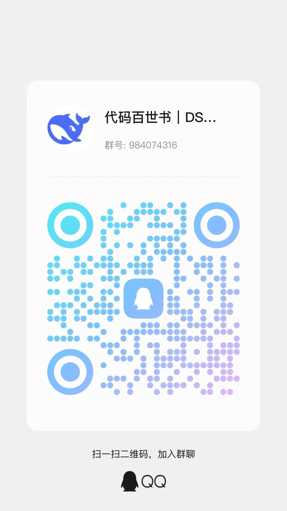
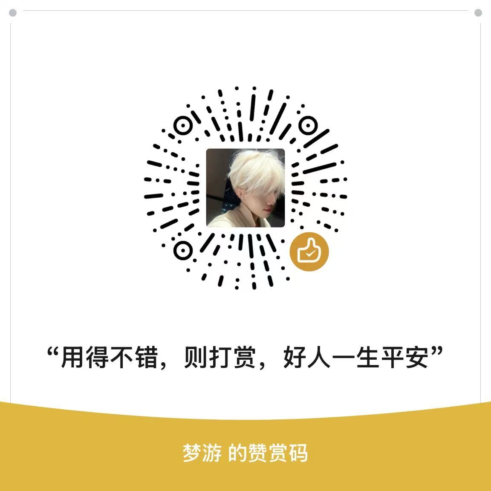

# 🤖 MengBot —— 中文优先的 AI 机器人团队

  
  
  

**简体中文（默认）**

> **一个人干不完的活，交给一支机器人团队。**

MengBot 不是一个大聊天框，而是一支能接活的团队：按角色拆分机器人（指挥、工程师、运营、客服…），派活、接力、互相检查。桌面端 + 自托管服务端，中文优先，接入国内与海外主流模型；数据留在你自己的机器上。

## ✨ 核心能力

| 能力 | 你能得到 |
|---|---|
| **机器人团队** | 每个机器人有自己的角色、记忆、工具与工位；一条任务派下去，谁接手、做到哪一步都看得见 |
| **五端同步** | Windows / macOS / Linux 桌面端，iOS / Android 手机，Web —— 同一账号、同一会话、同一套机器人 |
| **远程访问** | 手机扫码或配对链接连回自己的电脑，不在同一 WiFi 也能查看对话、批准操作、派发新任务 |
| **本地优先** | 对话、文件、工作区都在本机数据目录；自带模型账号即可用 |
| **中文优先** | 默认中文界面与文档，模型接入覆盖国内与海外主流供应商 |

## 💻 支持的平台

| 平台 | 安装方式 |
|---|---|
| Windows | [安装版](https://github.com/EternalNight996/mengbot/releases/download/v0.1.0/MengBot-0.1.0-setup.exe) · [便携版](https://github.com/EternalNight996/mengbot/releases/download/v0.1.0/MengBot-0.1.0-x64.exe) · [zip](https://github.com/EternalNight996/mengbot/releases/download/v0.1.0/MengBot-0.1.0-x64.zip) |
| macOS | [Apple Silicon](https://github.com/EternalNight996/mengbot/releases/download/v0.1.0/MengBot-0.1.0-mac-arm64.zip) · [Intel](https://github.com/EternalNight996/mengbot/releases/download/v0.1.0/MengBot-0.1.0-mac-x64.zip) |
| Linux | [AppImage](https://github.com/EternalNight996/mengbot/releases/download/v0.1.0/MengBot-0.1.0-x86_64.AppImage) · [deb](https://github.com/EternalNight996/mengbot/releases/download/v0.1.0/MengBot-0.1.0-amd64.deb) |
| iOS | [Web Clip 描述文件](https://github.com/EternalNight996/mengbot/releases/download/v0.1.0/MengBot-0.1.0-ios.mobileconfig) · 或 Safari 打开 [下载页](https://app.mengbot.vip/download.html#ios) |
| Android | [下载 APK](https://github.com/EternalNight996/mengbot/releases/download/v0.1.0/MengBot-0.1.290-android.apk) |
| Web | https://app.mengbot.vip |

## 🚀 快速开始

1. 打开 [www.mengbot.vip](https://www.mengbot.vip/) 或 [Releases](https://github.com/EternalNight996/mengbot/releases/tag/v0.1.0) 下载桌面端；
2. 登录同一 MengBot 账号（或使用配对码把手机接到这台电脑）；
3. 建一个机器人，给它角色与工具，开始派活。

## 📱 手机连接电脑

- **同一个 WiFi**：桌面端「设置 → 远程访问 → 配对设备」，手机扫码/打开局域网地址，输入配对码；
- **不在同一 WiFi**：同一入口复制「配对链接」，手机用流量打开即可；
- 连不上先看防火墙：Windows 当前 WiFi 设为「专用网络」，并允许 MengBot 通过防火墙。

## 🧩 架构

- **桌面端**：Electron + Vite/React；
- **服务端**：内置 Node harness，负责会话、机器人、工具与事件流；
- **共享内核**：客户端与服务端共用的类型与逻辑在 `shared/`、`packages/contracts`；
- **数据**：本地 SQLite 消息库与工作区目录，默认不出本机。

## 📄 License

Apache-2.0

## 💬 交流群 & 赞助

**MengBot 与 [memory-eternal](https://github.com/EternalNight996/memory-eternal) 共用同一个交流群 —— 遇到问题、想提需求、想聊聊 AI 机器人，欢迎进群：**

| QQ 交流群 | 微信交流群 |
|:---:|:---:|
|  |  |

**如果 MengBot 帮你省下了时间，可以请作者喝杯咖啡（微信 / 支付宝任选其一）：**

| 微信收款码 | 微信赞赏码 | 支付宝 |
|:---:|:---:|:---:|
|  |  |  |

> 打赏完全自愿，不影响任何功能；MengBot 始终开源（Apache-2.0）。详见 [SPONSOR.md](SPONSOR.md)。
